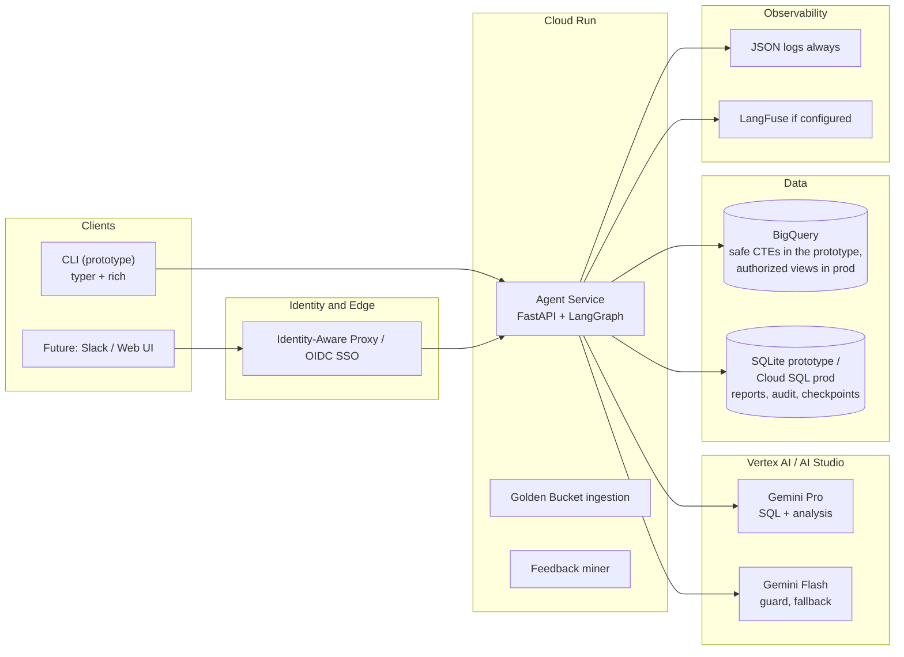
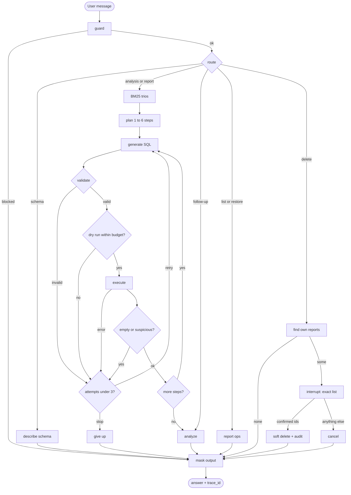

# Retail Data Analysis Chat Assistant

**Author:** Djanibek Khudaybergenov
**Assignment:** Opsfleet AI Engineer take-home
**Dataset:** `bigquery-public-data.thelook_ecommerce` (`orders`, `order_items`, `products`, `users`)
**Status:** working prototype. Requirements 2, 3, 5, and 7 are implemented. 1, 4, 6, and 8 are designed, with a local Golden Bucket stub and a hot-reloaded persona file so the design is visible in the code.

The full design write-up is also in [`docs/HLD.md`](docs/HLD.md). Diagrams live in [`docs/architecture.md`](docs/architecture.md).

`src/agent/data/bq_client.py` follows the assignment starter `bq_client.py` by Alex Freidman. `BigQueryRunner.__init__(self, project_id: Optional[str] = None, dataset_id: Optional[str] = "bigquery-public-data.thelook_ecommerce")` is unchanged. The prototype adds `dry_run()` and `maximum_bytes_billed` on `execute()` / `query()`. The client is created lazily, so a missing project or credential is an error at query time rather than a crash at import.

---

## 0. Summary

Non-technical retail executives ask business questions in English. The agent plans the question, writes BigQuery SQL, checks it in code, runs it, and answers in business language. They can discuss the result and save a report with insights and action items.

The loop is a **LangGraph** state machine around **Gemini** (`langchain-google-genai`). The model id is `GEMINI_MODEL_PRO` / `GEMINI_MODEL_FLASH` in the environment, because the reviewers test with a Google AI Studio key and free-tier names and quotas move.

**Core rule:** the LLM proposes; deterministic code enforces. PII handling, brand scope, byte budgets, and deletions are not prompt-only.

Production target: Cloud Run, Vertex AI Gemini, BigQuery authorized views with row-level security, Cloud SQL for PostgreSQL (reports, audit, checkpoints, `pgvector`), GCS for Golden Bucket files, Secret Manager, LangFuse, and Cloud Monitoring. The prototype uses SQLite, JSON logs, BM25, and the public dataset directly because that dataset cannot host our views.

---

## 1. Problem and success criteria

An executive who asks "why is Texas underspending versus California?" should not file a ticket and wait for a static answer. They cannot read SQL, so every answer states the metric, the period, and the brand scope. The warehouse is read-only. The only mutable state is the agent's own store (reports, preferences, checkpoints).

| Dimension | Target |
|---|---|
| Correctness | Execution accuracy ≥ 85% on a golden set; numbers in the narrative come from the result frames |
| Safety | 0 PII leaks; 0 cross-brand reads; ≥ 95% of the red-team set refused |
| Resilience | The CLI never crashes; ≥ 70% of first-attempt SQL errors self-correct; ≤ 3 SQL attempts per sub-question |
| Cost | Hard cap on bytes scanned (`BQ_MAX_BYTES`, default 1 GB) |
| Debuggability | Every answer carries a `trace_id` that points at prompts, SQL, retries, and masking |

Initial targets, to be agreed with the client. The offline suite in this repo gates safety and the retry loop. It does not claim a live accuracy number.

---

A line-by-line map of requirements to files, tests, and the exact prompts to type is in [`docs/REQUIREMENTS_CHECKLIST.md`](docs/REQUIREMENTS_CHECKLIST.md).

## 2. Prototype versus design

| # | Requirement | In this repo | Design only |
|---|---|---|---|
| 1 | Hybrid intelligence (Golden Bucket) | **Stub.** `golden_bucket/trios.jsonl` (11 trios) and BM25 via `GoldenRetriever.search` | GCS ingestion, embeddings, `pgvector` + full text, analyst review, no auto-promote |
| 2 | Safety and PII masking | **Implemented.** Guard, safe CTEs, sqlglot gate, output and log masker | Authorized views, policy tags, row access policies, SSO |
| 3 | High-stakes oversight | **Implemented.** SQLite reports, `interrupt()`, exact ids, soft delete, restore, audit | Same flow on Cloud SQL, 30-day purge job |
| 4 | Learning loop | **Hook only.** Explicit preferences ("I prefer tables", "forget my preferences") | Inferred preferences, nightly feedback miner, eval gate |
| 5 | Resilience | **Implemented.** 3 attempts, identical-SQL stop, empty/suspicious checks, Pro→Flash fallback, byte budget, CLI handler | Circuit breaker is included; multi-region model fallback is not |
| 6 | Quality assurance | **Small.** `pytest` plus `evals/run_eval.py` (red team, SQL gate, PII fixture) | 50–100 question golden set, LLM-as-judge, release gates |
| 7 | Observability | **Implemented.** JSON logs with a span per node, `/trace`, `/stats`. LangFuse if keys are set | Cloud Monitoring alerts |
| 8 | Persona | **Stub.** `config/persona.yaml`, re-read when the file mtime changes | LangFuse Prompt Management, staging label, eval gate, rollback |

---

## 3. Assumptions

These are explicit so a reviewer can challenge them. Open questions for Opsfleet are listed in [`docs/HLD.md`](docs/HLD.md) section 3.2.

| ID | Assumption |
|---|---|
| A1 | Product ownership is by **brand**. `config/entitlements.yaml` maps a demo user to brands. Alice: Calvin Klein, Allegra K. Bob: Tommy Hilfiger. |
| A2 | Direct PII (`first_name`, `last_name`, `email`, `street_address`, `latitude`, `longitude`) and `postal_code` are never selected. `city`, `age`, `state`, `country`, `gender`, `traffic_source` are allowed in aggregates. `user_id` is exposed only as a salted `FARM_FINGERPRINT`. |
| A3 | Revenue is `SUM(sale_price)` where status is not Cancelled or Returned. Margin is `sale_price - products.cost` on those items. `orders` has no amount column. |
| A4 | Churn, until the client defines it: at least one historical order and none in the last 90 days. The agent is told to state this definition. |
| A5 | Timestamps are UTC. The agent is told to state the range it used and not to invent one. |
| A6 | A customer is in scope only if they bought an entitled product. Spend counts only entitled products. |
| A7 | There is no real auth. `--user alice` or `--user bob` picks the entitlement. Production would use SSO and ignore any identity the model claims. |
| A8 | Reports are private. A user can delete and restore only their own rows. |
| A9 | The evaluation set is English. |

Asking for a brand outside the user's list returns an explicit "you don't have access" message and does not run SQL.

---

## 4. Data model and PII

```
users(id, first_name, last_name, email, age, gender, street_address, postal_code,
      city, state, country, latitude, longitude, traffic_source, created_at)
orders(order_id, user_id, status, gender, created_at, shipped_at, delivered_at,
       returned_at, num_of_item)
order_items(id, order_id, user_id, product_id, inventory_item_id, status, sale_price,
            created_at, shipped_at, delivered_at, returned_at)
products(id, name, brand, category, department, cost, retail_price, sku,
         distribution_center_id)
```

Joins: `order_items.order_id → orders.order_id`, `order_items.product_id → products.id`, `orders.user_id` / `order_items.user_id → users.id`.

The public dataset cannot host our `analytics_safe` views, so the SQL validator rewrites every base table into a CTE that selects only allowed columns, hashes ids, and filters `brand IN UNNEST(@entitled_brands)`. The brand list and the salt are query parameters. They are never string-formatted into SQL. Entitlements come from `UserContext`, which the CLI fills from the YAML file.

---

## 5. Architecture



The prototype process is one CLI. It holds a LangGraph graph, a SQLite checkpointer (so a confirmation survives inside the session), a SQLite report library, an in-process LRU cache, and a JSON log. LangFuse is attached only when `LANGFUSE_PUBLIC_KEY` and `LANGFUSE_SECRET_KEY` are set. If that import or export fails, the turn still finishes.

Why these choices, briefly:

- **LangGraph** keeps validate → dry-run → execute as fixed edges, and `interrupt()` plus a checkpointer is the deletion confirmation.
- **Gemini via `langchain-google-genai`** matches how the client tests. Pro is used for SQL and analysis; Flash is the fallback (and the optional guard classifier). Switching model ids is configuration.
- **BigQuery** is the system of record. `maximum_bytes_billed` is the cost backstop. Dry run is free and runs first.
- **SQLite** stands in for Cloud SQL: reports, audit, preferences, and LangGraph checkpoints.
- **sqlglot** is the SQL allow-list. The model cannot skip it.

---

## 6. Agent flow



State (simplified) lives in `src/agent/state.py`: user id and brands, messages, intent, trios, plan, current step, SQL, attempt count, result frames, a pending delete (ids + hash + expiry), and `trace_id`. The checkpointer is `SqliteSaver`.

Routing of destructive intents is heuristic and does not trust the model. "Delete the reports…" cannot be reached by a classifier alone. Simple questions such as "monthly revenue in 2023" skip the planner call so a free-tier key is not spent on an extra round trip. "Why…", "compare…", and report requests are planned into at most six sub-questions.

Guard rules always run (injection, PII requests, DML against warehouse tables, obvious off-topic). A Flash classifier runs only when `LLM_GUARD=always`, or `LLM_GUARD=suspicious` (the default) and the text looks like a jailbreak that the rules did not already block. `LLM_GUARD=off` uses rules only. This is deliberate: a free-tier key should not be called on every turn before any SQL is written.

---

## 7. Data flow

Alice asks: "Why are users in Texas underspending compared to California?"

1. The CLI passes `{user: alice, session, text}`. Brands are loaded from entitlements. A `trace_id` is minted.
2. The guard sees an on-topic analytics question.
3. The router chooses `analysis`. The question contains "why" and "compared", so the planner runs. BM25 is likely to return trio `gb-0003`, which decomposes underspending into customers, orders per customer, and average order value.
4. Gemini returns one `SELECT`. The validator parses it, rejects PII columns, rewrites `order_items` and `users` to `safe_order_items` and `safe_users`, and adds `LIMIT 1000`.
5. Parameters are `entitled_brands = ['Calvin Klein', 'Allegra K']` and `pii_salt`. The brand names do not appear in the SQL text.
6. Dry run checks bytes. Execute uses `maximum_bytes_billed`. The frame is cached under a key that includes the SQL, the parameters, and the user id.
7. Further sub-questions repeat steps 4–6. An empty frame is retried once with a hint about casing and date range, then reported as no data. Negative revenue is retried once, then the turn stops rather than narrating a bad number.
8. Analysis is prompted with the frames, the persona, and any explicit format preferences. The narrative is masked before it is saved and masked again before it is shown.
9. The CLI prints the narrative, a markdown table of the frames, a definitions line, and `trace: <id> · N queries · bytes · seconds`.

A follow-up such as "explain that" stays on the existing frames. A new metric goes through SQL again.

---

## 8. How each requirement is handled

### 8.1 Hybrid intelligence — design, prototype stub

Analyst trios (question, SQL, report, metrics) teach the agent how a person decomposed a similar question. Production stores them in GCS, validates the SQL with a dry run, embeds `question + interpretation`, and retrieves with reciprocal rank fusion over `pgvector` and Postgres full text. New trios from the agent enter an analyst queue and are never auto-promoted.

The prototype reads `golden_bucket/trios.jsonl` and ranks with BM25 (`rank_bm25`), so retrieval costs no API calls. The interface is `GoldenRetriever.search(question, k)`. Retrieved ids are written on the trace and cited in the answer ("Approach based on analyst report gb-…"). If nothing matches, the agent continues with the schema notes alone.

### 8.2 Safety and PII — prototype

Four independent layers:

| Layer | Where | What it stops |
|---|---|---|
| L1 Guard | Before any SQL | Injection phrases, "emails of customers", DML/DDL aimed at warehouse tables, obvious off-topic |
| L2 Data shape | Safe CTEs (authorized views in prod) | A compromised model still cannot read raw PII columns or other brands |
| L3 SQL validator | `sqlglot`, before dry run | More than one statement, non-SELECT, unknown tables, cross-project refs, forbidden columns, `SELECT *` from users, missing scope parameters, limit above 1000 |
| L4 Masker | Final text and every log line | Emails, phones, card numbers, street addresses, labelled postal codes. Person names only when they match a real `first_name`/`last_name` value or a label such as "customer Jane Doe". Product titles and categories are not treated as names. |

"Show me the emails of the top 10 customers" is refused, with an offer to use `customer_key` instead. The BigQuery client is not called.

### 8.3 High-stakes oversight — prototype

Tables `reports` and `audit_log` live in SQLite (`var/agent.sqlite` by default).

For "Delete all reports mentioning Client X" or "Delete all the reports we made in this conversation":

1. The search is `owner_user_id = me AND deleted_at IS NULL`. "This conversation" adds `session_id`. "Mentioning X" is a keyword filter on title and body, applied in Python after the scoped query so the mention string is never interpolated into SQL.
2. Zero rows: "No matching reports." No confirmation.
3. One or more: `interrupt()` pauses the graph and shows a numbered list. The pending action stores the id list, a sha256 of `user_id|ids`, and a 10 minute expiry.
4. Resume with `Command(resume=...)`. `yes` deletes exactly those ids. `1,3` deletes that subset. Anything else cancels. More than 20 rows requires typing `delete N`.
5. A report created after the list was shown is not deleted, because the code does not search again.
6. Soft delete and the audit insert share one transaction. `/restore` undoes the latest delete within 30 days. Other users' reports are never listed.

The model is not given a `delete(query=...)` tool. The LLM proposes, the human decides, the code executes.

### 8.4 Learning loop — design, small hook

Production would store explicit and inferred preferences (format, depth, charts, default period), mine failing traces nightly, and promote only human-approved trios through an eval gate. The prototype stores explicit preferences when the user says "I prefer tables" or "keep it short", answers "what do you remember about me?", and clears them on "forget my preferences". Keys are a whitelist (`format`, `depth`, `charts`, `default_period`). No PII is stored. The profile is added to the analysis prompt.

### 8.5 Resilience — prototype

Order of checks: sqlglot (local) → BigQuery dry run → execute with `maximum_bytes_billed`.

- At most 3 attempts per sub-question. The retry prompt includes the question, the previous SQL, and the validator or BigQuery error.
- The same SQL string on the next attempt stops the loop.
- Empty results are retried once with a casing and date-range hint, then answered as no data.
- Suspicious results (negative revenue or margin, all-null rows, more than 1000 rows) are retried once, then the turn stops.
- Gemini calls time out after `GEMINI_TIMEOUT_SECONDS` (default 90). A simple question is two calls (SQL, then analysis). SQL uses `thinking_level=minimal`; analysis uses `low`. Planning runs only for "why" / compare / report questions, on the Flash tier. The guard does not call the model unless the text already looks like a jailbreak. See [Latency and limits](#latency-and-limits).
- 429/503/timeouts retry once, then fall back to Flash when that id is different. A retired model id, 404, invalid key, or permission error is not retried and is not described as "busy".
- The default model id is `gemini-3.8-flash` for both tiers. `gemini-2.5-*` returns 404 for new keys. `GEMINI_MODEL_PRO` is the configurable Pro-tier id; leave it on Flash unless you accept the extra latency.
- The answer footer lists each node's duration. `/trace` shows the same spans, plus the SQL prompt size.
- BigQuery credential and project errors stop immediately with a setup message. Transient warehouse errors are retried, then the user is told to `/retry`.
- Successful frames are cached in-process, keyed by SQL + parameters + user.
- `handle_message` catches unexpected exceptions, logs a masked error, prints `Something went wrong (trace …)`, and keeps the session open.

### 8.6 Quality assurance — design, small prototype eval

`pytest` covers the PII masker, the SQL validator (including "over budget does not execute" and "Alice's brands are parameters"), the delete interrupt flow, and the retry loop, all with a scripted model and a fake BigQuery client. `python evals/run_eval.py` scores the red-team phrases, the SQL reject/accept cases, and a PII fixture. It prints `execution accuracy: n/a (offline)`. It does not invent a live score.

The production program in the HLD (execution accuracy, faithfulness, release gates, online LangFuse scores) is not built here.

### 8.7 Observability — prototype

Every node writes one JSON line to `logs/agent.jsonl`: `trace_id`, `span`, `duration_ms`, `status`, and a details object. Payloads pass through the PII masker first. A `turn` span records intent, query count, bytes, persona version, golden ids, and mask hits.

`/trace <id>` prints the spans, including SQL, attempt number, bytes, and errors. `/stats` shows this session and all-time rates from `logs/agent.jsonl` (guard blocks, self-correction, give-ups, p50/p95, bytes, PII hits). Delete confirmations are not counted as errors. The answer footer always shows the `trace_id` and a per-node timing line (`nodes: generate_sql 3.2s, execute 1.1s, …`). Money columns are rounded to two decimals in that table.

LangFuse is optional. With both keys set, a LangChain callback is added to the graph config. A missing package, a missing key, or an exporter error does not fail the turn.

### 8.8 Persona — design, prototype stub

Safety and SQL rules live in code (`agent/llm/prompts.py` and the validator). Tone, structure, and the report template live in `config/persona.yaml` with a `version` field. `PersonaStore` re-reads the file when its mtime changes, and the version is logged on the turn. Production would move that block to LangFuse Prompt Management with a staging label, an eval gate, and rollback. A non-developer could change tone without a deploy, and could not weaken the validator by editing the persona.

---

## 9. Error handling

| Failure | What the user sees |
|---|---|
| Injection, off-topic, PII request | A short refusal and, for PII, an offer to use `customer_key` |
| Brand outside scope | "You don't have access to … Your scope is …" and no query |
| SQL syntax, forbidden column, unknown column | "Refining" via retry, then a give-up that quotes the last issue |
| Dry run over `BQ_MAX_BYTES` | A message about narrowing the query. Execute is not called |
| Empty result | An honest no-data answer after one retry |
| Gemini missing | `GOOGLE_API_KEY is not set`. Schema and reports still work |
| Gemini 429/503/timeout | Retry once, then Flash if it is a different id, then "The model is busy right now. Try `/retry`" |
| Gemini 404, retired model, bad key, permission | `Model <id> not available: <reason>. Set GEMINI_MODEL_PRO and GEMINI_MODEL_FLASH in .env` |
| BigQuery missing or down | Setup instructions, or "data warehouse is temporarily unavailable, try `/retry`" |
| Golden Bucket or LangFuse down | The turn continues. Retrieval becomes zero-shot. Logs stay local |
| Delete reply is ambiguous, expired, or tampered | "Deletion cancelled. Nothing was deleted." |
| Any other exception | "Something went wrong (trace …)". The REPL stays up |

---

## 10. Framework choice

**LangGraph**, not a free-form tool loop.

- The safety path is a fixed graph. The model only fills in nodes.
- `interrupt()` and `Command(resume=...)` with a checkpointer are the deletion confirmation, and they match requirement 3 directly.
- Checkpointers move from SQLite to Postgres without rewriting nodes.
- LangChain callbacks are the LangFuse hook. Each node is already a span in the JSON log.
- Gemini is `langchain-google-genai` for AI Studio and can be `langchain-google-vertexai` in production. The graph does not change.

Alternatives considered: Google ADK / Vertex AI Agent Engine (credible on GCP, less explicit HITL), CrewAI or AutoGen (too much autonomy for this path), and a hand-rolled function-calling loop (retries, pause/resume, and persistence would be rebuilt by hand).

**My experience:** I have used LangGraph in production for a **Text-to-SQL agent** (schema-aware generation, validation and a 2-retry self-correction loop, evaluated on a hold-out set) and a **multi-step research agent**, plus RAG systems with hybrid retrieval and LangFuse-based tracing/evaluation. This design reuses those patterns directly.
<!-- TODO(Djanibek): adjust this paragraph to your exact experience and numbers from the CV. -->

---

## 11. Repository

```
README.md                          submission HLD, setup, real run
docs/HLD.md                        full design
docs/architecture.md               Mermaid diagrams and the delete flow
docs/REQUIREMENTS_CHECKLIST.md     requirement to file, test, and live prompt
requirements.txt
pyproject.toml
.env.example                       no secrets
Dockerfile
config/settings.py                 pydantic-settings
config/entitlements.yaml           demo users to brands
config/persona.yaml                hot-reloaded tone
config/metrics.yaml                revenue, margin, AOV, churn
golden_bucket/trios.jsonl
src/agent/cli.py                   typer + rich REPL
src/agent/graph.py                 LangGraph wiring
src/agent/nodes/                   guard, route, plan, SQL, reports, delete, mask
src/agent/safety/                  sqlglot gate, safe schema, PII masker
src/agent/data/bq_client.py        BigQueryRunner (starter signature + dry_run)
src/agent/store/reports_repo.py    SQLite reports, audit, preferences
src/agent/obs/                     JSON logs, optional LangFuse
evals/run_eval.py                  offline red-team and SQL gate
tests/                             offline; mocked LLM and BigQuery
```

CLI: free text, `/reports`, `/save [title]`, `/restore [id]`, `/whoami`, `/trace <id>`, `/stats`, `/retry`, `/help`, `/exit`. Flags: `--user`, `--model`, `--verbose`, `--session`.

---

## 12. Setup

```bash
python -m venv .venv && source .venv/bin/activate
pip install -r requirements.txt
pip install -e .

cp .env.example .env
# set GOOGLE_API_KEY and GCP_PROJECT. PII_SALT should be a long random string.
# LANGFUSE_* can stay empty.

# BigQuery needs a billing project even for the public dataset.
gcloud auth application-default login

python -m agent.cli --user alice
```

On Windows PowerShell, allow the venv activate script for this window only, then use the Windows path:

```powershell
Set-ExecutionPolicy -Scope Process Bypass
python -m venv .venv
.venv\Scripts\activate
pip install -r requirements.txt
pip install -e .
copy .env.example .env
gcloud auth application-default login
python -m agent.cli --user alice
```

Without those credentials the CLI still starts. It will answer "what data is available?", manage reports, and explain why analysis cannot run. It will not traceback.

Useful overrides:

| Variable | Role |
|---|---|
| `GEMINI_MODEL_PRO` | SQL and analysis. Default `gemini-3.8-flash` (set a Pro id only if you want that latency) |
| `GEMINI_MODEL_FLASH` | Fallback and planning. Default `gemini-3.8-flash` |
| `GEMINI_TIMEOUT_SECONDS` | Per-request Gemini timeout. Default `90` (free-tier SQL often needs this) |
| `BQ_MAX_BYTES` | Dry-run ceiling and `maximum_bytes_billed`. Default `1000000000` |
| `PII_SALT` | Salt inside `FARM_FINGERPRINT` |
| `LLM_GUARD` | `suspicious` (default), `always`, or `off` |
| `LLM_ROUTE` | `heuristic` (default) or `always` |

`--model` overrides the Pro id for one process.

Tests and the offline eval need no keys:

```bash
pytest
python evals/run_eval.py
```

Optional container (still needs a mounted gcloud config and an env file if you want live data):

```bash
docker build -t retail-agent .
docker run -it --env-file .env -v ~/.config/gcloud:/root/.config/gcloud retail-agent --user alice
```

---

## 13. Example session

Real run on the Gemini free tier, 18 Nov 2026. User `alice` (Calvin Klein, Allegra K), model `gemini-3.8-flash`, one BigQuery query.

```text
you> What were our top 5 products by revenue last quarter?

| id    | name                                                          | revenue |
| 20041 | Calvin Klein Mens 2 Button Solid Black Wool Suit              | 519.98  |
| 20232 | Calvin Klein Body Mens Black Windowpane Slim Fit Wool Suit    | 399.98  |
| 24113 | Calvin Klein Men's Traditional Coat                           | 398.00  |
| 20090 | Calvin Klein Sportswear Men's Washable Pindot Jacket         | 356.00  |
| 19831 | Calvin Klein Sportswear Men's Solid Classic Fit Sport Coat   | 339.00  |

Insight: the five products together are $2,012.96. The leading suit is about 26% of that top five.
Approach based on analyst report gb-0002, gb-0011, gb-0007.
trace: … · 1 queries · 8249316 bytes · 90.0s
nodes: guard 0ms, route 1ms, retrieve 0ms, plan 0ms, generate_sql 76.0s, validate_sql 76ms, dry_run 2.7s, execute 1.7s, check_result 0ms, analyze 9.5s, mask 1ms
```

Product titles were not masked. Revenue is two decimals. The citation is the Golden Bucket stub (BM25), not a fabricated report id.

A 20 second timeout aborted `generate_sql` twice on this same question before the timeout was raised. The 76 second call is one successful request, not a retry loop: validate, dry-run, and execute were each a single pass.

---

## Latency and limits

Free-tier `gemini-3.8-flash`, measured on that run:

| Node | Time | What it is |
|---|---|---|
| guard, route, retrieve, plan, check, mask | under 2 ms | Local. "Top 5 products" is one step, so the planner does not call the model (`plan 0ms`). |
| generate_sql | 76.0 s | First Gemini call. Writes the SELECT. |
| validate_sql | 76 ms | sqlglot, local. |
| dry_run | 2.7 s | BigQuery dry run, 8.2 MB, under the 1 GB cap. |
| execute | 1.7 s | The only billed query. |
| analyze | 9.5 s | Second Gemini call. Five rows in, a short insight out. |
| Total | 90.0 s | Dominated by the first model call. |

Why SQL is much slower than analysis on the same model: `thinking_level=low` was already set on both calls, and neither call uses structured output. The prompts are the same order of magnitude (a short schema plus one trio, versus five result rows). The gap is the free-tier queue on the first request, plus the model doing more reasoning to write SQL ("last quarter", joins, `ROUND`, `LIMIT`) than to summarise five numbers. The follow-up call is warm, which is why analysis was 9.5 s.

What we changed after that run, without a new live measurement: SQL calls now request `thinking_level=minimal` and at most 512 output tokens, and the SQL prompt drops empty "previous error" sections. The default timeout is 90 s so a 76 s call is not aborted. A 20 s cap timed out twice and never reached BigQuery.

A later live run of `create a report for Q1 including insights and action items for Q2` spent 177 s in an LLM planner and then timed out in `generate_sql` at 90 s (268 s total) and returned "the model is busy." Reports no longer do that. The planner is a fixed six-query template (month, products, categories, returns, new versus returning customers, quarter versus the previous quarter). The quarter with no year is the latest complete one on or before `MAX(orders.created_at)` in the user's brands (one scoped dry run and query, cached for the session). If that lookup fails, the window is today's date, and the report says which one it used. Dates in the template SQL are query parameters. Each statement still goes through the SQL gate, the brand rewrite, the dry run, and the byte cap. There is one narrative call. If that call fails, the report header says why (`Narrative skipped: Gemini rate limit (429)`, a timeout, or a 404) and the trace records the same reason. A 429 is retried once, after the suggested pause, only if that pause still fits the turn budget. The saved fallback is executive prose (dollars, percents, and quarter-on-quarter deltas), with template-based action items chosen from the numbers, not a raw field dump. A timeout now says it timed out and suggests `/retry`, instead of calling the model busy. A turn is capped at 3 model calls and 150 seconds; if the budget runs out after some queries, the answer uses the rows already in hand.

Production mitigations, not in this prototype:

- A paid Gemini tier or provisioned throughput, so the first call is not sitting in the free-tier queue.
- A smaller or non-thinking model for SQL only, with Flash or Pro reserved for the narrative.
- Prompt and result caching (the prototype already caches identical BigQuery frames in memory; it does not cache Gemini responses).
- Streaming the analysis tokens so the wait is visible. The CLI today blocks until the call returns.

---

## How this was built

Djanibek Khudaybergenov wrote the architecture and the safety design (the HLD, the four safety layers, the delete confirmation rules, and the requirement split between prototype and design). The Python in this repository was generated by a Cursor AI agent under his direction. He reviewed it, ran it live against Gemini and BigQuery, and sent back the failures that changed the code: the PII masker was eating product titles, the first model was a retired id, a 20 second timeout was too short for free-tier SQL, and a 404 was reported as "the model is busy." Those fixes are his review, not an unattended run. The framework-experience paragraph in [Framework choice](#10-framework-choice) still has his placeholder; replace it with your own background before you submit.

---

## 14. What was verified, and what was not

Verified in this environment:

- `pytest` — offline tests (scripted model, fake BigQuery). Covers PII masking (including product titles that must not become `[NAME]`), log masking, the SQL gate, brand parameters, over-budget rejection, the delete interrupt, the retry loop, 429 fallback, a retired model id (not reported as "busy"), money rounded to cents, and a CLI that stays up even when a local `.env` contains a key.
- `python -m agent.cli --help` and `python -m agent --help`.
- A piped REPL as `alice` with no `GOOGLE_API_KEY` and no `GCP_PROJECT`: banner explains both, schema and `/whoami` work, the email request is refused, `/exit` returns 0.
- `python evals/run_eval.py`: red-team 6/6, SQL rejections 4/4, PII leak count 0. Execution accuracy is printed as `n/a`.

Verified live on 18 Nov 2026 (free-tier `gemini-3.8-flash`, user alice): the top-5 product question in section 13, including Golden Bucket citations, two-decimal revenue, unmasked product names, one dry run, and one execute. Node times are from that run.

Not verified live:

- The failure paths (bad SQL retry, empty result, 429, BigQuery down). Those are covered by offline tests.
- A side-by-side alice/bob brand check. Alice's rows were all Calvin Klein, which matches her entitlement, but Bob was not run in that session.
- The delete confirmation prompts and the Q1 report prompt. Routing and the interrupt flow are tested offline.
- LangFuse export, and the Docker image against a live project.

The SQL-call change after that run (`thinking_level=minimal`, shorter prompt, 90 s timeout) has not been timed live.
