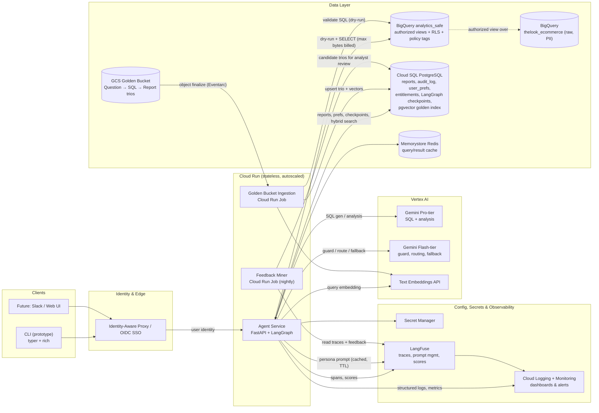
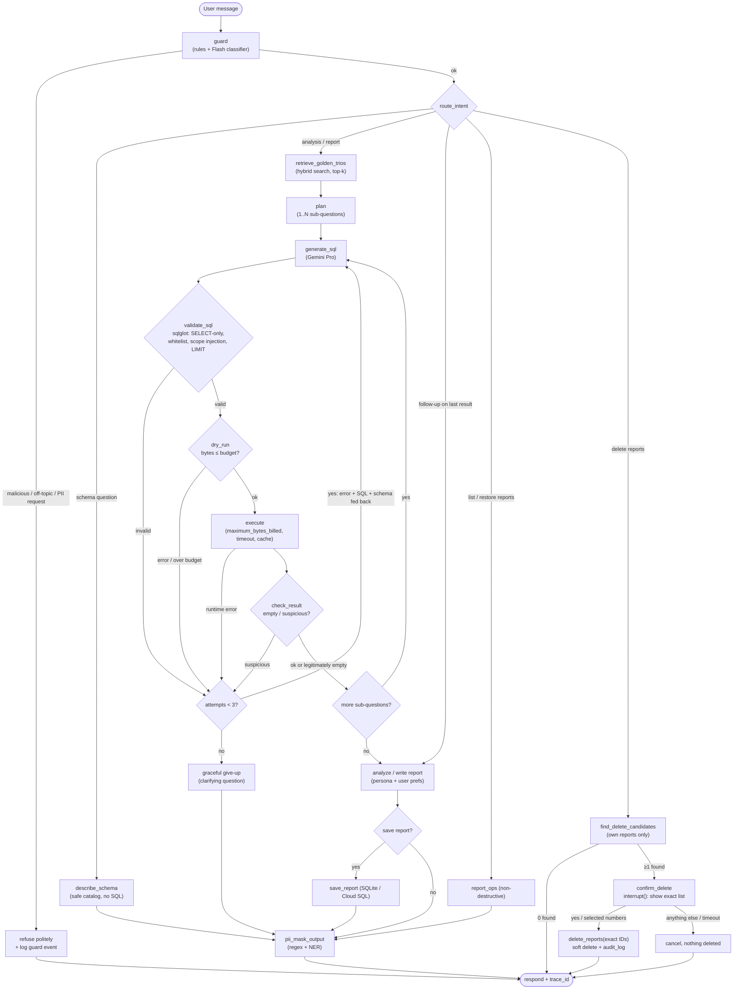

# Retail Data Analysis Chat Assistant: High-Level Design & Technical Explanation

> Opsfleet AI technical assignment. Dataset: `bigquery-public-data.thelook_ecommerce`.
> Status: this file is the full design. The prototype in this repository implements requirements 2, 3, 5, and 7, plus the Golden Bucket and persona stubs from section 12. `README.md` is the submission write-up (architecture, flow, how each requirement is handled, setup, and an illustrative session). Live Gemini and BigQuery were not available in the build environment, so example output is illustrative and the test suite is offline.

---

## 0. TL;DR

- **What:** A conversational analytics agent. Non-technical executives ask business questions in plain English, discuss the answers, and save reports with action items. A CLI is the prototype interface; the same agent service can later sit behind Slack or a web UI.
- **How:** A **LangGraph** state machine around **Gemini**. Each question goes through a fixed pipeline: guard → intent routing → Golden Bucket retrieval → SQL generation → deterministic validation → BigQuery dry run → execution → result checks → analysis → PII masking → response. Destructive actions take a separate branch with **human-in-the-loop confirmation** (`interrupt()`).
- **Core principle:** *The LLM proposes; deterministic code enforces.* PII protection, per-user data scoping, cost limits and deletions are enforced in code and data permissions, never only in a prompt.
- **Production target:** GCP. Cloud Run (agent), Vertex AI Gemini, BigQuery authorized views + row-level security, Cloud SQL for PostgreSQL (reports, audit, preferences, checkpoints, `pgvector` Golden Bucket index), GCS (Golden Bucket raw trios), Secret Manager, LangFuse + Cloud Monitoring.
- **Prototype scope:** Requirements 2 (PII), 3 (oversight), 5 (resilience) and 7 (observability) are implemented. 1, 4, 6 and 8 are designed; a light local Golden Bucket stub and a hot-reloadable persona file are included because they cost little and make the design tangible.

---

## 1. Problem Statement & Success Criteria

### 1.1 Problem
Today an executive with a question ("Why is state X underspending compared with state Y?") files a request with an analyst and waits hours or days for a static answer that cannot be discussed further. Executives do not know SQL and cannot check a query themselves.

**Goal:** Give non-technical retail executives self-service, safe and reliable access to sales analytics through conversation, with answers comparable to a human analyst's.

### 1.2 Users
| Persona | Needs |
|---|---|
| Executive (primary) | Fast, trustworthy answers in business language; follow-up questions; reports with insights and action items; their preferred format |
| Analyst (secondary) | Curates the Golden Bucket and reviews candidate trios; audits agent answers |
| Ops / Admin | Edits persona/tone without a deploy; monitors health, cost and quality |

### 1.3 Constraints
- Users cannot verify SQL, so **correctness and transparency** come first. Every answer states its metric definition, period and filters.
- Raw data contains **PII**, which must never reach the output.
- Each user may analyze **only data for products related to them**.
- The analytics database is **read-only**. The only mutable state is the agent's own stores (reports, preferences, config).
- Gemini free tier rate limits and the BigQuery cost budget.

### 1.4 Success criteria
| Dimension | Criterion (initial targets, to be agreed with client) |
|---|---|
| Correctness | Execution accuracy ≥ 85% on the offline golden set; numbers in the narrative match the query results |
| Safety | **0 PII leaks** (hard release gate); 0 cross-scope data access; ≥ 95% of the red-team set refused or neutralised |
| Resilience | The CLI never crashes; every failure ends in a clear user message; ≥ 70% of first-attempt SQL errors self-corrected |
| Cost | Hard cap on bytes scanned per query; ≤ 3 LLM SQL attempts per sub-question |
| Latency | p50 < 10 s, p95 < 30 s for single-step questions; reports may take longer, with progress shown |
| Debuggability | Any answer can be traced to its prompts, SQL, retries and masking via a `trace_id` |

---

## 2. Scope: Prototype vs Design-Only

| # | Requirement | Prototype | Design |
|---|---|---|---|
| 1 | Hybrid Intelligence (Golden Bucket) | **Stub**: local JSONL trios + BM25 retrieval used as few-shot examples | Full: GCS → ingestion job → embeddings → `pgvector` hybrid search → analyst-reviewed update loop |
| 2 | Safety & PII Masking | **Implemented** (4 layers) | Plus BigQuery authorized views, policy tags, row access policies, SSO |
| 3 | High-Stakes Oversight | **Implemented** (SQLite, `interrupt()`, soft delete, restore, audit) | Same, on Cloud SQL |
| 4 | Learning Loop | Design only (optional: explicit preference memory) | User preference store + system-level feedback mining |
| 5 | Resilience | **Implemented** | Plus circuit breakers, multi-region model fallback |
| 6 | Quality Assurance | Small eval script + unit tests (planned) | Full offline/online evaluation programme |
| 7 | Observability | **Implemented**: JSON logs always, LangFuse optional | LangFuse + Cloud Monitoring dashboards and alerts |
| 8 | Persona Management | **Stub**: hot-reloaded `persona.yaml` | Versioned prompt store (LangFuse Prompt Management) edited by non-devs, with eval gate and rollback |

---

## 3. Assumptions & Open Questions

### 3.1 Assumptions (explicit, so reviewers can challenge them)
| ID | Assumption | Why / Impact |
|---|---|---|
| A1 | **Product ownership by brand.** `products` has no owner column, so access is defined by an **entitlements mapping** `app_user → [brand]` (`config/entitlements.yaml` in the prototype; a Cloud SQL table in production). | Drives the code-injected scope filter. Swapping in category or distribution-centre scope is a config change. |
| A2 | **PII:** direct identifiers `first_name`, `last_name`, `email`, `street_address`, `latitude`, `longitude` are never exposed. `postal_code` is treated as a quasi-identifier and excluded. `city`, `age`, `state`, `country`, `gender`, `traffic_source` are allowed **in aggregates**. `users.id` / `user_id` is exposed only as a salted pseudonymous hash. | "Top customers" stays possible without revealing identity. |
| A3 | **Revenue** = `SUM(order_items.sale_price)` over items whose `status NOT IN ('Cancelled','Returned')`. **Margin** = `sale_price − products.cost`. | `orders` has no amount column. The definition is stated in every answer. |
| A4 | **Churn** (until the client defines it): a customer with ≥ 1 historical order and no order in the last 90 days, measured month over month. | The answer to "why did churn spike?" depends on this definition, so the agent always states it. |
| A5 | Timestamps are treated as UTC. Relative periods ("last month", "Q1") are resolved against the current date, and the agent states the exact range it used and flags it when the data does not cover that range. | Avoids silent period errors. |
| A6 | **Users in scope** for customer analytics are customers who bought at least one entitled product; spend is counted only on entitled products. | A brand owner should not see spend on other brands. |
| A7 | The prototype has no real auth. The CLI user is chosen with `--user` and mapped to entitlements. Production uses SSO (Google Workspace/Identity-Aware Proxy or OIDC). | Lets the demo show scoping between users. |
| A8 | Saved reports are private to their author. Users can delete only their own reports. | As stated in the brief. |
| A9 | English is the interaction language; Gemini handles other languages, but the evaluation set is English. | |

### 3.2 Open questions for the client (Opsfleet)
1. **Product ownership:** What defines "products related to a user": brand, category, distribution centre, or an explicit assignment table? Can one user own several scopes, and do admins see everything?
2. **PII policy:** Is `city`/`postal_code`/`age` considered PII for you? Is a minimum aggregation size (k-anonymity, e.g. suppress groups < 5 customers) required?
3. **Identity:** Which IdP/SSO? Are there roles (exec, analyst, admin)? Where do entitlements live today?
4. **Metric definitions:** The official definitions of churn, active customer, revenue (gross vs net of returns), and fiscal quarters.
5. **NFRs:** Number of users and query volume, latency expectations, monthly LLM and BigQuery budget, data residency (EU/US), retention for conversations and logs.
6. **Golden Bucket:** Its current format and size, who owns curation, and how often analysts produce new trios.
7. **Reports:** Should reports be shareable? What is the retention and restore window for deleted reports (assumed 30 days)?
8. **Channels:** Is the CLI only for the prototype, with Slack/Teams/web as the real target? This affects auth and the confirmation UX.

---

## 4. Data Model & PII Classification

```
users(id, first_name, last_name, email, age, gender, street_address, postal_code,
      city, state, country, latitude, longitude, traffic_source, created_at)
orders(order_id, user_id, status, gender, created_at, shipped_at, delivered_at,
       returned_at, num_of_item)
order_items(id, order_id, user_id, product_id, inventory_item_id, status, sale_price,
            created_at, shipped_at, delivered_at, returned_at)
products(id, name, brand, category, department, cost, retail_price, sku,
         distribution_center_id)
```
Joins: `order_items.order_id → orders.order_id`, `order_items.product_id → products.id`, `orders.user_id / order_items.user_id → users.id`.

| Class | Columns | Treatment |
|---|---|---|
| Direct PII | `first_name`, `last_name`, `email`, `street_address`, `latitude`, `longitude` | **Not present** in the safe layer; any reference is rejected by the validator |
| Quasi-identifier (excluded) | `postal_code` | Not present in the safe layer |
| Identifier | `users.id`, `*.user_id` | Replaced with `customer_key = FARM_FINGERPRINT(CONCAT(@salt, CAST(id AS STRING)))` consistently in every table, so joins still work |
| Analytical, aggregate-safe | `age`, `gender`, `city`, `state`, `country`, `traffic_source`, `created_at` | Allowed; optional small-cell suppression (design) |
| Business | all `orders`, `order_items`, `products` columns | Allowed, row-scoped by brand entitlement |

---

## 5. Production Architecture (GCP)

### 5.1 Architecture diagram



### 5.2 Components, choices and trade-offs
| Component | Choice | Why | Alternatives considered |
|---|---|---|---|
| Agent runtime | **Cloud Run** (container: FastAPI + LangGraph) | Stateless and scales to zero; long request timeouts suit multi-step reports; no cluster to operate. State lives in Postgres checkpoints, so any instance can resume a conversation or a pending confirmation. | GKE: more control, more ops. Cloud Functions: short timeouts, awkward for streaming. Vertex AI Agent Engine: viable managed option, but less control over the graph runtime and harder to run locally. |
| LLM | **Gemini via Vertex AI** (prod), Google AI Studio key (prototype). Pro-tier model for SQL and analysis, Flash-tier for guard, routing and fallback. Model IDs are config. | The client tests with Gemini. Vertex adds IAM, VPC-SC, regional data residency and higher quotas. Tiering cuts cost and latency. | Other providers are supported behind the LangChain chat-model interface but not required. |
| Analytics DB | **BigQuery** `analytics_safe` dataset: authorized views (no PII columns, hashed keys), **row access policies** by brand, **policy tags** (column-level security) on raw PII | Enforces safety at the data layer independently of the agent. `maximum_bytes_billed` per job caps cost. | Masking only in the app: rejected as a single point of failure. |
| Operational store | **Cloud SQL for PostgreSQL**: `reports`, `audit_log`, `user_preferences`, `entitlements`, `feedback`, LangGraph checkpoints, **`pgvector`** golden index | One transactional store: soft delete + audit in one transaction; `langgraph-checkpoint-postgres` exists; `pgvector` + `tsvector` give hybrid search. The Golden Bucket is thousands of trios, not millions. | Firestore: fine for documents, weaker for transactional audit and hybrid search. Vertex AI Vector Search: scales to billions but needs an always-on endpoint, which is overkill here; the upgrade path is documented. |
| Golden Bucket raw | **GCS** (versioned bucket) | It is described as a data lake; object versioning gives history; Eventarc triggers ingestion. | |
| Cache | **Memorystore (Redis)** keyed by normalized SQL + scope + data freshness | Avoids repeat BigQuery scans and LLM calls for popular questions. | BigQuery's own 24 h result cache (also on, and free); a Postgres cache table for small scale. |
| Secrets | **Secret Manager** (Gemini key, LangFuse keys, hashing salt) | No secrets in images or repos. | |
| Observability | **LangFuse** (traces, prompt management, scores) + **Cloud Logging/Monitoring** (metrics, alerting, SLOs) | LangFuse is LLM-native: nested spans, token cost, prompt versions, eval scores. Cloud Monitoring handles paging. | LangSmith (SaaS only, tied to LangChain), Arize Phoenix, OpenTelemetry → Cloud Trace (also emitted for infra). |
| Identity | IAP / OIDC SSO → `user_id` → entitlements | The agent never trusts a user-supplied identity. | |
| Networking/IAM | Dedicated service account: `bigquery.jobUser` + `dataViewer` on `analytics_safe` **only**; no access to raw dataset; VPC-SC perimeter | Least privilege: even a fully compromised agent cannot read raw PII. | |

### 5.3 Extensibility
Capabilities are **tools in a registry** (`tools/`) with typed schemas, each tagged with a risk level (`read`, `write`, `destructive`, `external`). The router and planner see only tools allowed for the user's role. New capabilities plug in as nodes or tools without touching the core loop:
- **Charts:** `render_chart(result_ref, spec)` → PNG/Vega to GCS (risk: read).
- **Email a report:** `send_report(report_id, recipients)` (risk: external → same `interrupt()` confirmation as delete).
- **Web trends:** `web_search(query)` (risk: external read; output treated as untrusted and kept away from the SQL path).

---

## 6. Agent Design (LangGraph)

### 6.1 Agent flow diagram



### 6.2 State (simplified)
```python
class AgentState(TypedDict):
    user: UserContext            # id, role, entitled_brands (from auth, never from the LLM)
    session_id: str
    messages: Annotated[list, add_messages]
    intent: str
    golden_trios: list[Trio]
    plan: list[SubQuestion]
    current_step: int
    sql: str | None
    attempts: int                # per sub-question, max 3 (1 + 2 retries)
    last_error: str | None
    results: list[ResultRef]     # small, masked result frames + metadata (bytes, rows)
    pending_delete: PendingAction | None   # exact IDs + hash + expiry
    trace_id: str
```
Checkpointer: `SqliteSaver` (prototype) / `PostgresSaver` (prod). It keeps multi-turn context and lets the graph pause on `interrupt()` and resume.

### 6.3 Node responsibilities
| Node | Type | Responsibility |
|---|---|---|
| `guard` | Rules + Flash | Injection patterns, PII-seeking intent ("emails of top customers"), off-topic, DML/DDL requests. Fails closed for clear attacks and soft-redirects borderline cases ("I can show top customers by pseudonymous ID and spend"). |
| `route_intent` | Flash, structured output | `schema` · `analysis` · `report` · `follow_up` · `report_list/restore` · `report_delete` · `chitchat`. |
| `retrieve_golden_trios` | Code | Hybrid search, top-3 trios above a similarity threshold (see §8.1). |
| `plan` | Pro, structured output | Splits multi-step questions and reports into 1–6 sub-questions (e.g. "Q1 revenue by month", "top categories", "state comparison", "return rate"). |
| `generate_sql` | Pro | Prompt contains the safe schema, metric definitions (A3–A5), golden trios as few-shot examples, the previous error if retrying. Output: one BigQuery Standard SQL `SELECT`. |
| `validate_sql` | **Deterministic** | See §8.2 layer 3. |
| `dry_run` | **Deterministic** | BigQuery `dry_run=True`: catches unknown columns/tables free of charge and returns `total_bytes_processed`; rejects above budget (default 1 GB). |
| `execute` | **Deterministic** | `BigQueryRunner` with `maximum_bytes_billed`, timeout and row cap; result cache. |
| `check_result` | Code + Flash | Empty result → check whether filters are plausible (value casing, date range vs data range) before declaring "no data". Suspicious → negative revenue, row explosion from a bad join, etc. |
| `analyze` | Pro | Business narrative grounded **only** in result frames; states definitions, period, filters; recommendations as action items; persona + user-preference formatting. |
| `pii_mask_output` | **Deterministic** | Final-text scrub (§8.2 layer 4). |
| Delete branch | Code + `interrupt()` | §8.3. |

---

## 7. Data Flow Walkthrough (one question)

User `alice` (entitled brands: *Brand A*, *Brand B*) asks:
**"Why are users in Texas underspending compared to California?"**

1. **CLI → agent.** The CLI sends `{user_id: alice, session_id, text}`. The agent loads `UserContext` from entitlements, starts a LangFuse trace (`trace_id`), and loads the persona and Alice's preferences.
2. **guard.** No injection, no PII request, on-topic → pass.
3. **route_intent** → `analysis` (multi-step, comparative "why").
4. **retrieve_golden_trios.** Hybrid search returns e.g. "Why do customers in region X spend less than Y?". The analyst's SQL compared **customer count, orders per customer, average order value and category mix**. This tells the agent *how analysts decompose "underspending"*.
5. **plan** → three sub-questions: (a) revenue, customers, orders/customer and AOV per state; (b) category mix per state; (c) traffic source mix per state.
6. **generate_sql (a)**, e.g.:
   ```sql
   SELECT u.state, COUNT(DISTINCT oi.user_id) AS customers,
          COUNT(DISTINCT oi.order_id) AS orders, SUM(oi.sale_price) AS revenue
   FROM order_items oi JOIN users u ON oi.user_id = u.id
   WHERE u.state IN ('Texas','California') AND oi.status NOT IN ('Cancelled','Returned')
   GROUP BY u.state
   ```
7. **validate_sql.** It parses the query, checks tables and columns against the whitelist (`u.id`, `oi.user_id` are mapped to the hashed `customer_key`), and **rewrites** each table reference into a scoped, PII-free CTE (brand filter `IN UNNEST(@brands)` with Alice's brands passed as a query parameter). It adds `LIMIT 1000`.
8. **dry_run** → 0.4 GB ≤ 1 GB budget → OK.
9. **execute** → two rows. **check_result** → non-empty, values positive → OK. Steps (b) and (c) repeat 6–9.
10. **analyze.** Gemini receives the three small result frames plus the golden report style. It writes: "Texas generates X% less revenue per customer than California. The gap comes mostly from lower order frequency (…), not basket size. Category mix is similar; Texas has a larger share of customers from `Search` traffic… **Action items:** …". It states the revenue definition, the period, and that the scope is Brand A/B only.
11. **pii_mask_output.** No hits (a counter is logged anyway).
12. **respond.** Rendered with `rich` (Alice prefers tables), with a footer showing the `trace_id`, bytes scanned and the definitions used. Follow-up questions such as "and what about returns?" reuse the conversation state.
13. **Observability.** The trace contains spans for every node: prompts, SQL before and after rewrite, bytes, rows, retries, masking events, latency and tokens.

---

## 8. How Each Requirement Is Handled

### 8.1 Requirement 1: Hybrid Intelligence (Golden Bucket) (*design; prototype = stub*)

**Purpose.** Analysts have already solved similar questions. Reusing *their interpretation* (which metrics define "underspending", which joins, which caveats) is more reliable than generating from scratch.

**Trio format** (one JSON/MD object per trio in GCS):
```json
{"id": "gb-0042", "question": "...", "sql": "...", "report_md": "...",
 "metrics": ["revenue","aov"], "tables": ["order_items","users"],
 "author": "analyst@corp", "created_at": "...", "schema_version": "v3",
 "status": "approved", "quality_score": 4.5}
```

**Ingestion pipeline** (GCS `finalize` event → Eventarc → Cloud Run Job):
1. **Validate:** parse the SQL with sqlglot, dry-run it against the *current* `analytics_safe` schema, and reject or flag stale trios.
2. **Sanitize:** scrub PII from the report text (same masker as runtime) and rewrite raw-table references to safe views.
3. **Enrich:** extract metadata (tables, metrics, time grain), summarize the report into "interpretation notes".
4. **Embed:** Vertex AI text embeddings of `question + interpretation notes`; build a `tsvector` for keyword search.
5. **Upsert** into the Postgres `golden_trios` table with a `pgvector` HNSW index. Idempotent on `id + content hash`.

**Query-time retrieval.**
- Hybrid: dense (cosine on embeddings) + sparse (Postgres full-text) → **Reciprocal Rank Fusion** → top-3.
- Filters: `status='approved'`, compatible `schema_version`, similarity threshold. If nothing passes, fall back to zero-shot with schema docs (no forced irrelevant examples).
- Usage: the trios go into the `plan` and `generate_sql` prompts as **few-shot examples of interpretation and SQL patterns**, and the analyst report goes into `analyze` as a guide for structure and style. Cited in the answer ("Approach based on analyst report gb-0042").
- Cached per normalized question.

**Update loop.**
- **Analyst-authored:** drop files into GCS → automatic ingestion.
- **Agent-harvested:** interactions with positive feedback, a successful first or corrected execution and no guard events become **candidate trios** (nightly Feedback Miner, §8.4). They enter an **analyst review queue** and are **never auto-promoted**, which prevents poisoning and the spread of subtle errors.
- **Hygiene:** nightly re-validation dry-runs all approved SQL. Schema drift marks trios `stale`. Usage and quality counters let low performers be demoted.

**Prototype stub:** `golden_bucket/trios.jsonl` with about 10 hand-written trios over the four tables. Retrieval uses **BM25** (`rank_bm25`), so no extra API calls hit free-tier limits. Same interface (`GoldenRetriever.search(q, k)`), so the pgvector implementation is a drop-in swap.

### 8.2 Requirement 2: Safety & PII Masking (*prototype*)

**Principle: defense in depth.** Each layer is independent; the LLM is never the last line of defense.

| Layer | Where | Mechanism | Stops |
|---|---|---|---|
| L1 Input guard | before the LLM does any work | Regex/heuristics (injection phrases, SQL keywords like `DROP`, explicit PII asks) + Flash classifier with structured output `{allowed, category, reason}` | Off-topic use, jailbreaks, "give me customer emails" |
| L2 Data layer | BigQuery | **Prod:** `analytics_safe` authorized views without PII columns, salted-hash `customer_key`, policy tags on raw columns, row access policies by brand; the agent SA cannot read the raw dataset. **Prototype:** the public dataset cannot host our views, so L3 rewrites every table reference into an equivalent **safe CTE** (allowed columns only, hashed keys, brand filter) | Leaks even if the LLM is fully compromised |
| L3 SQL validator | before execution | `sqlglot` AST: exactly one statement; `SELECT` only (no DML/DDL/scripting, `EXPORT`, external functions); tables ⊆ whitelist; columns ⊆ allowed set (also blocks `SELECT *` on users); **code-injected scope**: every `products`/`order_items` reference is replaced by a CTE filtered by `brand IN UNNEST(@brands)`; brand values passed as **query parameters**, never string-concatenated; forced `LIMIT`; no cross-dataset references | Prompt-injected SQL, scope escape, cost bombs |
| L4 Output masker | final text **and** anything written to logs/traces | Regex (email, phone, card-like numbers, street-address patterns) + NER (Presidio or spaCy) for person names + a deny-list check against any raw PII value that might appear | Residual leaks, e.g. PII in a golden report or model hallucination |

**Scope (products related to the user).** Entitlements come from authentication, never from the conversation. "Show me Brand C" for a user without Brand C produces an empty scope plus an explicit message ("you don't have access to Brand C"), not a silent zero.

**Small-cell suppression** (design, if the client confirms Q2): aggregates over quasi-identifiers with < k customers are suppressed or bucketed.

**Other abuse controls:** per-user rate limits; max sub-questions per request; tool access by role; retrieved content (golden reports, future web results) is wrapped as *data*, never as instructions.

### 8.3 Requirement 3: High-Stakes Oversight (*prototype*)

**Saved Reports library** (SQLite in the prototype, Cloud SQL in prod):
```
reports(id, owner_user_id, session_id, title, body_md, tags, created_at, deleted_at NULL)
audit_log(id, actor_user_id, action, report_ids JSON, request_text, trace_id, ts)
```

**Flow for "Delete all reports mentioning Client X" or "Delete all the reports we made in this conversation":**
1. **Candidate search, code-scoped.** The query **always** includes `owner_user_id = :me AND deleted_at IS NULL`. "In this conversation" maps deterministically to `session_id = :current`. "Mentioning X" uses keyword search on title/body; the LLM may only **filter or rank within** this already-scoped candidate set and returns IDs, which are intersected with the set (so the LLM cannot introduce foreign IDs).
2. **0 found** → "No matching reports." No confirmation prompt.
3. **≥ 1 found** → `interrupt()` pauses the graph and shows an **exact numbered list** (title, date, short snippet):
   `Found 3 reports: 1) "Q1 sales – Client X" (12 Nov) 2) ... Delete all 3? [yes / numbers e.g. 1,3 / no]`
4. **Resume** with `Command(resume=answer)`:
   - `yes`/`all` → delete exactly the shown IDs. `1,3` → that subset. Anything else → **cancel** (fail-safe default).
   - The pending action stores the **ID list + hash + expiry (10 min)**. The deletion executes on that stored list and is **not re-searched**, so new matching reports created in between are untouched.
   - Large batches (> 20) require typing the count ("delete 23"), a friction step proportional to the risk.
5. **Execution by code**: one transaction sets `deleted_at = now()` and writes `audit_log`.
6. **Undo without breaking UX:** "Deleted 3 reports. Type `/restore` within 30 days to undo." A purge job hard-deletes after 30 days (prod).

**Why the LLM must not call `delete_reports(query=...)` directly:** misinterpretation (fuzzy matching of "Client X"), prompt injection from report content or data, and no human visibility into an irreversible action. **Rule: the LLM proposes, the human decides, the code executes.** The same pattern applies to every future `destructive`/`external` tool (e.g. emailing a report).

### 8.4 Requirement 4: Continuous Improvement / Learning Loop (*design-only*)

**User level (personalization).**
- `user_preferences(user_id, key, value, source[explicit|inferred], confidence, updated_at)`. Example keys: `format` (table/bullets), `depth` (summary/deep-dive), `charts` (on/off), `default_period`, `currency_display`.
- **Explicit:** a lightweight `extract_preferences` step (Flash, structured output) detects statements like "I prefer tables" or "always shorter" and upserts them with confidence 1.0.
- **Implicit:** signals such as repeated "make it a table", consistently skipped long sections, or follow-ups asking for more detail raise inferred preferences above a threshold. Explicit always beats inferred.
- **Applied** at `analyze` as a compact "format profile" in the prompt. **Transparent and controllable:** "what do you remember about me?" and "forget my preferences" are supported. No PII is stored in preferences.

**System level (the agent improves).**
- **Signals:** thumbs up/down + optional comment, rephrase-within-60s, retries, give-ups, guard false positives, latency/cost outliers, all stored as LangFuse scores.
- **Nightly Feedback Miner (Cloud Run Job):**
  1. Clusters failing traces (embedding + error type) → top failure themes report for the team (e.g. "churn questions fail on date logic").
  2. Promotes **successful** interactions to **candidate trios** → analyst review queue → Golden Bucket (§8.1).
  3. Turns confirmed failures into **new regression cases** in the eval set (§8.6).
- **Changes ship through the eval gate:** improved prompts, metric definitions or few-shots are evaluated offline before promotion. No online self-modification of safety-relevant behavior.

### 8.5 Requirement 5: Resilience & Graceful Error Handling (*prototype*)

- **Cheap checks first:** sqlglot (local, free) → BigQuery dry run (free, returns bytes) → execution with `maximum_bytes_billed`. Most bad SQL never costs money.
- **Self-correction loop:** max **3 attempts per sub-question (1 + 2 retries)**. On each retry the LLM gets the original question, the previous SQL, the exact error/validator message and the relevant schema snippet. The corrected SQL goes through the **same** validation and dry run. Identical SQL on retry → stop early (no loop on the same mistake).
- **Empty results:** treated as a hypothesis, not an error. The agent checks distinct values for the filtered columns (e.g. `'texas'` vs `'Texas'`) and the date range against `MIN/MAX(created_at)`, retries once if a fix is evident, and otherwise answers honestly: "No orders for Brand A in Texas in that period."
- **Suspicious results:** negative revenue/margin, row-count explosion relative to the expected grain (join fan-out), NULL-only metrics → one retry with a hint.
- **LLM failures:** `tenacity` exponential backoff with jitter on 429/500/503/timeouts (max 3 tries) → **fallback Pro → Flash** for the same step → if still failing, a graceful message. A simple **circuit breaker** skips the primary model for N seconds after repeated failures.
- **BigQuery failures:** timeouts and retries on transient errors (the client library's retry for 5xx); on persistent outage: "The data warehouse is temporarily unavailable; your question is saved, try `/retry`."
- **Budget guards:** per-request ceilings on LLM calls, total bytes scanned and wall-clock time. The **query cache** (prototype: in-process LRU + BigQuery's result cache; prod: Redis) avoids duplicate spend.
- **The UI never crashes:** a top-level handler in the CLI loop catches everything, prints a friendly message with the `trace_id`, and keeps the session alive.

### 8.6 Requirement 6: Quality Assurance (*design-only; small prototype eval*)

**Offline (before every deploy, in CI):**
- **Golden eval set:** 50–100 questions built from approved Golden Bucket trios, stratified by category (customer behaviour, product performance, time metrics, schema questions, multi-step, reports), plus a **red-team set** (injection, PII extraction, scope escape, destructive requests).
- **SQL correctness:** *execution accuracy* (compare result sets order-insensitively with numeric tolerance against reference SQL), *valid SQL rate* on the first attempt, *self-correction success rate*, *empty result rate*, bytes scanned per question.
- **Answer quality:** *faithfulness*, i.e. every number in the narrative must appear in or derive from the result frames (a deterministic number-extraction check + LLM-as-judge); *answer relevance* (does it answer the asked question); *completeness* for reports (insights + action items + definitions present). Judges use a pinned model and a rubric, calibrated on ~30 human-labelled examples.
- **Safety:** **PII leak rate = 0 (hard gate)**, injection resistance ≥ 95%, off-topic refusal rate, 0 scope violations, guard false-positive rate.
- **Performance:** latency p50/p95, tokens and cost per question.
- **Release gates:** no safety regression; accuracy not below baseline minus tolerance; persona/prompt changes run the same gate.

**Verifying intent:** the agent restates its interpretation (metric definition, period, scope) in every answer, so users can catch misreadings. For ambiguous questions it asks one clarifying question instead of guessing. Analysts spot-check a weekly sample of production answers with the same rubric.

**UX evaluation:** task success rate, turns-to-answer, rephrase rate, abandonment, thumbs ratio, time-to-first-token; moderated sessions with 3–5 executives before rollout; canary/shadow rollout with online metrics compared to the previous version.

**Online:** LangFuse scores (user feedback + sampled LLM-as-judge on production traces) on a dashboard per prompt/model version.

### 8.7 Requirement 7: Observability (*prototype*)

**Three layers:**
1. **Traces (deep dive):** one LangFuse trace per user turn, `trace_id` shown to the user. Spans per graph node with: input/output (masked), prompt version, model, tokens, latency, SQL (generated and rewritten), validator verdict, dry-run bytes, rows, retry count and reason, guard decisions, masking hit counts, final answer. Session-level grouping lets you replay the whole conversation.
2. **Metrics (detect):** success rate, give-up rate, SQL error rate by type, self-correction success, empty-result rate, guard block rate, PII-mask hits (should be ≈ 0 because masking is the *last* layer; hits mean an upstream layer missed something), deletions confirmed vs cancelled, LLM fallback rate, 429 rate, latency p50/p95, cost per question, thumbs-down rate.
3. **Alerts (know first):** Cloud Monitoring log-based metrics, e.g. SQL error rate > 20%/1 h, p95 > 30 s, Gemini 429 bursts, any PII-mask hit in output (page), BigQuery bytes/day > budget, give-up rate spike after a prompt version change.

**PII in telemetry:** all payloads pass through the L4 masker **before** being logged. Telemetry must not become a leak.

**Prototype:** structured **JSON lines** (`logs/agent.jsonl`, one event per node with `trace_id`, `span`, `duration_ms`, `status`, metrics) are always on. **LangFuse** is enabled when `LANGFUSE_*` keys are set (LangChain callback handler + node spans). The CLI command `/trace <id>` pretty-prints a turn from the JSON log, and `/stats` prints session metrics.

### 8.8 Requirement 8: Agility / Persona Management (*design-only; prototype = stub*)

- **Split the prompt:** a **locked core** (safety rules, SQL rules, output-grounding rules) lives in code and is versioned with deploys. An **editable persona block** (tone, structure, length, vocabulary, report template) is stored outside the code. Non-devs can change tone but can never weaken safety.
- **Store:** **LangFuse Prompt Management**. A non-developer edits the `report_persona` prompt in a web UI; each save creates a version; the `production` label points at the active version. The agent fetches it with a short cache TTL (60 s), so changes go live **without redeploy**. An alternative store is a Postgres `prompt_configs` table with a minimal admin page.
- **Safety net:** a new version first gets the `staging` label → automatic eval-gate run (tone rubric + safety subset) → one click to promote to `production`; **instant rollback** by moving the label. Every answer logs the persona version it used.
- **Weekly CEO tone change** becomes an edit plus a promote, no engineering ticket.
- **Prototype:** `config/persona.yaml` with a `version` field, re-read when its mtime changes (hot reload, no restart).

---

## 9. Error Handling & Fallback Matrix

| Failure | Detection | Response | User sees |
|---|---|---|---|
| Malicious / off-topic input | L1 guard | Refuse; log guard event | Polite refusal + what the agent *can* do |
| Request for PII | L1 guard / L3 validator | Block; offer an aggregate or pseudonymous alternative | "I can't show personal details; here is the same analysis by customer key" |
| SQL syntax error / invalid column | sqlglot / dry run | Self-correct (≤ 2 retries) | Spinner "refining query…" |
| Forbidden table/column/statement | L3 validator | Self-correct once with the reason; repeat → refuse | Explanation |
| Query too expensive | dry run bytes > budget | Retry asking for narrower SQL (partition/date filter, fewer columns) | "Narrowing the query to stay within budget…" |
| BigQuery runtime error / timeout | job error | Retry transient; self-correct logical | Graceful message on give-up |
| Empty result | `check_result` | Value/date-range probe → one retry → honest "no data" | Explicit no-data answer with filters used |
| Suspicious result | `check_result` heuristics | One retry with hint | — |
| Gemini 429/503/timeout | exception | tenacity backoff → fallback model → message | "Model busy, retrying…", then an answer or "try again in a minute" |
| Gemini malformed output | Pydantic structured-output validation | One re-ask, then fallback | — |
| BigQuery outage | repeated errors / circuit breaker | Fast-fail; keep session | "Data warehouse unavailable, try `/retry`" |
| Golden Bucket / vector store down | exception | Continue zero-shot (degraded) + flag in trace | Nothing (quality may drop slightly) |
| LangFuse down | exporter error | Drop to JSON logs only; never block the request | Nothing |
| Persona store down | fetch error | Last cached version → bundled default | Nothing |
| Delete confirmation ambiguous / expired | resume value / TTL | Cancel, nothing deleted | "Deletion cancelled" |
| Unexpected exception | top-level handler | Log with trace; keep CLI alive | "Something went wrong (trace abc123)" |

---

## 10. Non-Functional Considerations

- **Cost:** Flash for cheap steps; Pro only for SQL and analysis; cached golden retrieval and results; dry-run budgets; `maximum_bytes_billed`; result frames truncated/summarized before going to the LLM (no large tables in prompts).
- **Latency:** parallel independent sub-questions (LangGraph fan-out) in reports; streaming of the final answer; progress messages per step.
- **Scalability:** stateless Cloud Run instances; Postgres for state; BigQuery scales independently. The model quota is the real bottleneck → Vertex AI provisioned throughput if needed.
- **Security & compliance:** least-privilege SA, VPC-SC, CMEK optional, regional data residency for Vertex/BigQuery, retention policy for conversations/traces (e.g. 30–90 days), audit log of destructive actions.
- **Data freshness:** results labelled with query time; cache keys include a freshness bucket.

---

## 11. Framework Choice: LangGraph

**Why LangGraph:**
- **Explicit state machine:** the safety-critical path (validate → dry run → execute) is fixed code. The LLM decides only *within* nodes. Conditional edges model the retry loop and routing cleanly.
- **Human-in-the-loop as a first-class primitive:** `interrupt()` + `Command(resume=...)` with a **checkpointer**, so a pending deletion survives process restarts, which is exactly what requirement 3 needs.
- **Persistence & multi-turn memory:** checkpointers (SQLite → Postgres) without changing code.
- **Observability:** native LangChain callbacks → LangFuse; each node is a span.
- **Extensibility:** new tools/nodes/subgraphs (charts, email, web search) plug in without rewriting the loop; the SQL pipeline is a reusable subgraph.
- **Model-agnostic:** Gemini through `langchain-google-genai` (AI Studio) or `langchain-google-vertexai` (prod); switching is config.

**Alternatives considered:**
- *Google ADK / Vertex AI Agent Engine:* Gemini-native and a credible option on GCP. I chose LangGraph for its explicit graph control, mature HITL and checkpointing, and because I have built production systems with it (lower delivery risk).
- *CrewAI / AutoGen (multi-agent):* too much autonomy for a safety-critical path; harder to guarantee deterministic validation order.
- *Plain function-calling loop:* simplest, but retries, HITL pause/resume, and persistence would have to be rebuilt by hand.

**My experience:** I have used LangGraph in production for a **Text-to-SQL agent** (schema-aware generation, validation and a 2-retry self-correction loop, evaluated on a hold-out set) and a **multi-step research agent**, plus RAG systems with hybrid retrieval and LangFuse-based tracing/evaluation. This design reuses those patterns directly.
<!-- TODO(Djanibek): adjust this paragraph to your exact experience and numbers from the CV. -->

---

## 12. Prototype: Scope & Repository Structure (planned)

**Stack:** Python 3.11+, LangGraph, `langchain-google-genai` (Gemini), `google-cloud-bigquery` via the provided `bq_client.py` `BigQueryRunner` (extended with `dry_run()` and `maximum_bytes_billed`), `sqlglot`, SQLite (reports, audit, checkpoints), `rank_bm25` (golden stub), `typer` + `rich` (CLI), `tenacity`, `pydantic`, `langfuse` (optional), `presidio-analyzer` or regex-only fallback, `pytest`.

```
opsfleet-retail-agent/
├── README.md                    # this HLD (condensed) + setup + example run
├── docs/
│   ├── HLD.md                   # full design (this document)
│   └── architecture.md          # Mermaid diagrams
├── pyproject.toml / requirements.txt
├── .env.example                 # GOOGLE_API_KEY, GCP_PROJECT, LANGFUSE_*, PII_SALT, BQ_MAX_BYTES
├── config/
│   ├── settings.py              # pydantic-settings, model IDs, budgets
│   ├── entitlements.yaml        # demo users → brands
│   ├── persona.yaml             # editable tone block (hot reload)
│   └── metrics.yaml             # revenue / churn / AOV definitions
├── golden_bucket/
│   └── trios.jsonl              # ~10 hand-written trios
├── src/agent/
│   ├── graph.py                 # LangGraph wiring + checkpointer
│   ├── state.py
│   ├── nodes/
│   │   ├── guard.py  route.py  retrieve.py  plan.py
│   │   ├── generate_sql.py  validate.py  execute.py  check_result.py
│   │   ├── analyze.py  reports.py  delete_flow.py  mask.py
│   ├── safety/
│   │   ├── sql_validator.py     # sqlglot whitelist + scope rewrite to safe CTEs
│   │   ├── safe_schema.py       # allowed columns, hashed keys
│   │   └── pii_masker.py        # regex + NER
│   ├── data/
│   │   ├── bq_client.py         # provided BigQueryRunner (+ dry_run, limits)
│   │   └── cache.py
│   ├── llm/
│   │   └── models.py            # Pro/Flash, tenacity, fallback, circuit breaker
│   ├── golden/retriever.py      # GoldenRetriever interface + BM25 impl
│   ├── store/reports_repo.py    # SQLite: reports, audit_log, soft delete/restore
│   ├── obs/
│   │   ├── logging.py           # JSON logs, trace_id, masked payloads
│   │   └── tracing.py           # optional LangFuse
│   └── cli.py                   # typer + rich REPL
├── evals/
│   ├── questions.yaml           # golden + red-team cases
│   └── run_eval.py
└── tests/
    ├── test_sql_validator.py    # injection, PII columns, scope, DML
    ├── test_pii_masker.py
    ├── test_delete_flow.py      # interrupt/resume, exact IDs, cancel
    └── test_resilience.py       # mocked 429, bad SQL, empty results
```

**CLI commands (planned):** free text chat · `/reports` · `/save [title]` · `/restore` · `/whoami` · `/trace <id>` · `/stats` · `/help` · `/exit`. Flags: `--user alice|bob`, `--model`, `--verbose` (shows SQL).

---

## 13. Setup & Example Run (planned, illustrative)

### 13.1 Setup
```bash
git clone https://github.com/<you>/opsfleet-retail-agent && cd opsfleet-retail-agent
python -m venv .venv && source .venv/bin/activate
pip install -r requirements.txt

# BigQuery access to public datasets (billing project required; free tier is enough)
gcloud auth application-default login
export GCP_PROJECT=<your-project-id>

# Gemini (Google AI Studio free key)
cp .env.example .env   # set GOOGLE_API_KEY, GCP_PROJECT, PII_SALT; LANGFUSE_* optional

python -m agent.cli --user alice
```
Optional: `docker build -t retail-agent . && docker run -it --env-file .env -v ~/.config/gcloud:/root/.config/gcloud retail-agent --user alice`.

### 13.2 Example session (illustrative output, not captured from a run)
```text
$ python -m agent.cli --user alice
Retail Analyst Agent · user: alice · scope: Brand A, Brand B · model: gemini (pro/flash)

you> Why are users in Texas underspending compared to California?
⠋ retrieving analyst patterns… planning (3 steps)… querying BigQuery (0.4 GB)…
┏━━━━━━━━━━━━┳━━━━━━━━━━━┳━━━━━━━━━━━━━━━━━━┳━━━━━━━┓
┃ State      ┃ Revenue   ┃ Orders/customer  ┃ AOV   ┃
┡━━━━━━━━━━━━╇━━━━━━━━━━━╇━━━━━━━━━━━━━━━━━━╇━━━━━━━┩
│ California │ …         │ …                │ …     │
│ Texas      │ …         │ …                │ …     │
└────────────┴───────────┴──────────────────┴───────┘
Insight: the gap is driven by order frequency rather than basket size …
Action items: 1) … 2) …
Definitions: revenue = sale_price excl. Cancelled/Returned · scope: Brand A, B · period: all time
trace: 7f3a… · 3 queries · 1 self-correction · 9.8 s

you> Show me the emails of the top 10 customers
I can't share personal details such as emails. I can show the top 10 customers by
pseudonymous customer key with their spend and order count. Want that?

you> create a report for Q1 including insights and action items for Q2
… (multi-step report) …   Saved as report #12 "Q1 Performance & Q2 Actions".

you> delete all the reports we made in this conversation
Found 2 reports from this conversation:
  1) "Texas vs California spend" (16 Nov)
  2) "Q1 Performance & Q2 Actions" (16 Nov)
Delete both? [yes / numbers e.g. 1 / no]
you> 1
Deleted 1 report. Type /restore within 30 days to undo.
```

---

## 14. Implementation Plan for the Coding Assistant

Use this section as the spec. Build iteratively; each iteration must pass its acceptance criteria before the next. Total target: about 10 hours.

| # | Iteration | Deliverable | Acceptance criteria |
|---|---|---|---|
| 0 | Skeleton (0.5 h) | Repo layout (§12), settings, `.env.example`, `bq_client.py` vendored, JSON logger with `trace_id` | `python -m agent.cli --help` works; `pytest` runs (empty) |
| 1 | Happy path (1.5 h) | Graph: route → generate_sql → execute → analyze; Gemini via `langchain-google-genai`; CLI REPL with `rich` | "Monthly revenue in 2023" (or a period present in the data) returns a correct table + narrative; multi-turn follow-up works via SQLite checkpointer |
| 2 | SQL safety (1.5 h) | `sql_validator.py`: single SELECT, whitelist, forbidden columns, **scope rewrite into safe CTEs with brand query params**, hashed customer key, forced LIMIT; `dry_run` with byte budget | Unit tests: `DELETE`/`DROP`/multi-statement rejected; `SELECT email` rejected; `SELECT *` from users rejected; generated SQL for alice never returns other brands; over-budget query rejected without execution |
| 3 | Resilience (1.5 h) | Retry loop (max 3 attempts), error feedback to LLM, empty/suspicious checks, tenacity + Pro→Flash fallback, LRU cache, top-level CLI error handler | Tests with mocked LLM/BQ: bad SQL fixed on retry; 3 failures → graceful message; simulated 429 → fallback model used; CLI never exits on exception |
| 4 | Guard + output masking (1 h) | `guard` node (rules + Flash classifier), `pii_masker` (regex + optional Presidio), masking applied to output **and** logs | Red-team cases refused (injection, "emails of customers", off-topic); a synthetic answer with an email/name is masked; logs contain no raw PII |
| 5 | Reports + HITL delete (1.5 h) | SQLite `reports`/`audit_log`; save/list/restore; delete branch with `interrupt()`, numbered list, exact-ID binding, expiry, soft delete | "Delete reports mentioning X" shows a list and deletes only confirmed IDs; "no" or other input cancels; other users' reports never listed; `/restore` works; audit rows written |
| 6 | Golden Bucket stub + planner (1 h) | `trios.jsonl` (~10), BM25 retriever, trios injected into plan/SQL prompts; planner for multi-step/report questions | Q1 report request yields ≥ 3 sub-queries + insights + action items; trace shows retrieved trio IDs |
| 7 | Observability (0.5 h) | Spans per node in JSON log; optional LangFuse callback; `/trace`, `/stats` | Every turn has a `trace_id`; `/trace` shows SQL, retries, bytes, latency; works with LangFuse disabled |
| 8 | Persona hot reload (0.25 h) | `persona.yaml` re-read on mtime change, version logged | Editing tone changes the next answer without restart |
| 9 | Evals + docs (1 h) | `evals/run_eval.py` over ~15 questions + red-team cases; README with setup, example run, diagrams, assumptions | Eval prints execution accuracy / PII leak count / latency; fresh clone runs following README only |

**Non-negotiable rules for generated code:**
- Never let the LLM's output bypass `validate_sql` → `dry_run`. Entitlements come only from `UserContext`.
- Brand filters are **query parameters**, never string-formatted into SQL.
- Deletion executes only stored, confirmed IDs, inside one transaction with an audit row.
- Everything logged passes through the PII masker.
- Small, typed, testable functions; no network calls in unit tests (mock LLM and BigQuery).

---

## 15. Risks & Future Work
- **Ambiguous business definitions** → resolve open questions (§3.2); add a semantic layer (metrics catalog, e.g. dbt semantic models) so SQL generation targets governed metrics.
- **LLM-as-judge bias** → calibrate against human labels; keep deterministic checks primary.
- **Golden Bucket drift** → nightly re-validation and analyst ownership.
- **Next capabilities:** charts (`render_chart`), scheduled reports and email delivery (with confirmation), web trend search (sandboxed), Slack interface, per-tenant cost dashboards.
