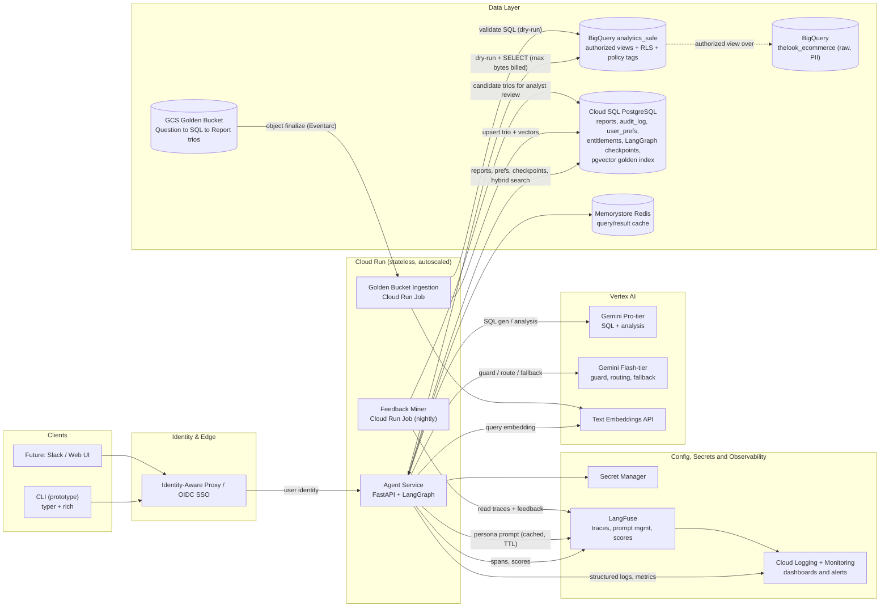
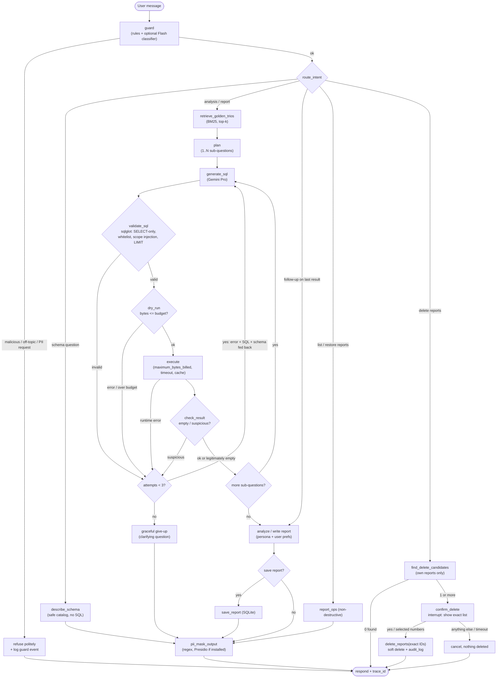

# Architecture diagrams

These are the same diagrams as the submission README. Production components are the target deployment. The prototype runs the agent loop, SQLite, JSON logs, and a BM25 Golden Bucket on one machine.

## Production architecture

## Agent flow

## Data flow for one question

Alice (brands Calvin Klein and Allegra K) asks why Texas customers underspend versus California.

1. The CLI sends her user id, the session id, and the text. Entitlements are loaded from `config/entitlements.yaml`. The model never supplies the brand list.
2. The guard checks injection, PII requests, DML, and off-topic text.
3. The router labels the turn as analysis. A "why / compare" question is planned into sub-questions. A plain "monthly revenue" question stays one step, which keeps free-tier calls down.
4. BM25 returns analyst trios. They are few-shot examples of how to decompose the question, not instructions.
5. Gemini proposes one `SELECT`. `sqlglot` rejects anything that is not a single read-only query, rejects PII columns and `SELECT *` from users, renames base tables to `safe_*` CTEs, and appends `LIMIT`.
6. Those CTEs drop direct identifiers, replace user ids with `FARM_FINGERPRINT(CONCAT(@pii_salt, ...))`, and filter `brand IN UNNEST(@entitled_brands)`. Brand strings and the salt travel as BigQuery query parameters.
7. A dry run must come back under `BQ_MAX_BYTES` (default 1 GB). Only then does `BigQueryRunner.execute` run with `maximum_bytes_billed`.
8. Empty or suspicious frames (negative revenue, for example) are sent back to the model with the error, up to 3 attempts. The same SQL twice stops the loop.
9. The narrative is written from the result frames. A report intent is saved to SQLite after masking.
10. The masker runs again on the final text. The CLI prints the answer, a definitions line, and the `trace_id`.

## Delete flow

"Delete all reports mentioning Client X" loads rows with `owner_user_id = alice` and a keyword match. Bob's reports are never selected. The graph calls `interrupt()` with that exact id list, a hash, and a 10 minute expiry. "yes" or "1,3" deletes only those stored ids, in one transaction with an audit row. Any other reply, a tampered hash, or an expired confirmation cancels. `/restore` undoes the last delete for 30 days.
